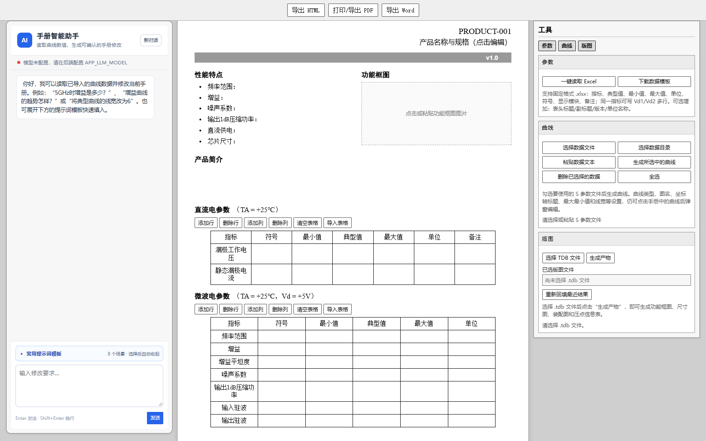

# 通用产品手册编辑器

在 Windows 上运行的产品手册编辑工具，支持 Excel 参数导入、曲线绘制、图像编辑、TDB 版图产物生成、智能助手以及 HTML、PDF、Word 导出。

默认模板使用通用产品型号、规格和技术支持占位文字。默认页、新增页和 Word 页眉不含单位标志或单位抬头。



## 环境

- Windows 10/11 64 位；后端依赖清单的目标环境为 Python 3.13 64 位。
- 从 GitHub 源码运行时需要 Node.js 22.12 或更新的兼容版本及 npm，用于构建网页。
- 智能助手需要自行配置兼容的模型接口；不配置时仍可编辑、绘制曲线和导出。
- TDB 版图生成需要用户自行安装并合法授权的 L-Edit；其他功能不依赖 L-Edit。

## 从源码首次启动

在工程根目录打开 PowerShell，逐项执行。无需激活虚拟环境。

```powershell
python -m venv .venv
.\.venv\Scripts\python.exe -m pip install -r requirements.txt
Copy-Item -LiteralPath .env.example -Destination .env
Set-Location frontend_v2
npm ci
npm run build
Set-Location ..
.\start.bat
```

已有 `.env` 时保留原文件，不要重复覆盖。打开 `http://127.0.0.1:5173/product-manual`；后端接口说明为 `http://127.0.0.1:8000/docs`。

若从 Releases 下载了带 `frontend_v2/dist` 的发布 ZIP，则可跳过 Node.js 安装和前端构建，仍须安装 Python 及 `requirements.txt`。本项目需要本地后端服务，上传 GitHub 仓库并不会自动产生可直接使用的在线编辑网站。

## L-Edit

公开版本提供软件官方链接和本地接入说明，不包含 L-Edit 安装包、可执行文件或许可证。

- [Siemens 官方 L-Edit 介绍](https://resources.sw.siemens.com/zh-CN/fact-sheet-tanner-l-edit-ic/)
- [L-Edit 本地配置与版图生成步骤](docs/L-Edit配置说明.md)

## 配置模型

根目录 `.env.example` 中的模型地址、模型名称和 API 密钥均留空。在本机 `.env` 填入实际配置并重新启动。不要将 `.env` 提交到 GitHub。

```dotenv
APP_LLM_BASE_URL=http://127.0.0.1:11434/v1
APP_LLM_MODEL=your-installed-model
APP_LLM_API_KEY=
APP_LLM_AUTH_TYPE=none
```

上例仅说明本地接口的配置格式，模型名称必须与实际服务一致；远程服务按服务商要求填写地址、鉴权方式和密钥。

## 文档

- [使用者说明](使用者说明.md)
- [开发者说明](开发者说明.md)
- [GitHub 公开上传操作流程](docs/GitHub上传操作流程.md)
- [公开版本变更说明](docs/公开版本变更说明.md)
- [第三方依赖说明](THIRD_PARTY_NOTICES.md)
- [本次验证记录](docs/验证记录.md)

## 构建与检查

```powershell
.\.venv\Scripts\python.exe -m pip install -r requirements-dev.txt
.\.venv\Scripts\python.exe -m pytest tests/test_contract.py tests/test_layout_port_grid.py
Set-Location frontend_v2
npm run lint
npm run build
Set-Location ..
.\.venv\Scripts\python.exe package.py ..\Manual-public.zip
```

发布 ZIP 带已构建网页，不带 Python 环境、npm 缓存、个人配置或运行产物。源码仓库忽略 `frontend_v2/dist`，克隆后需自行构建。

## 权利说明

公开可见不等于已授予开源许可。本工程未擅自添加 MIT 等开源许可证；项目权利人可在确定许可方式后添加正式 LICENSE。第三方依赖遵循各自许可，相关声明见 THIRD_PARTY_NOTICES.md。
